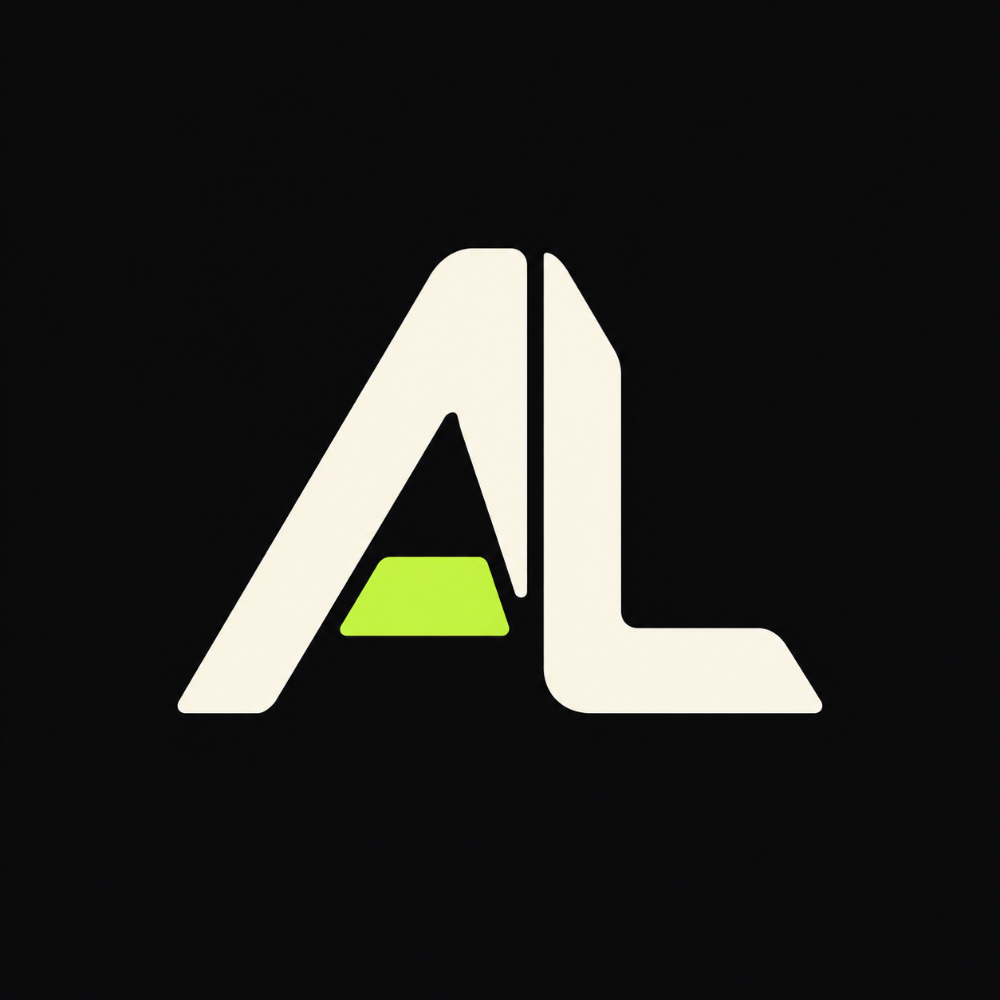
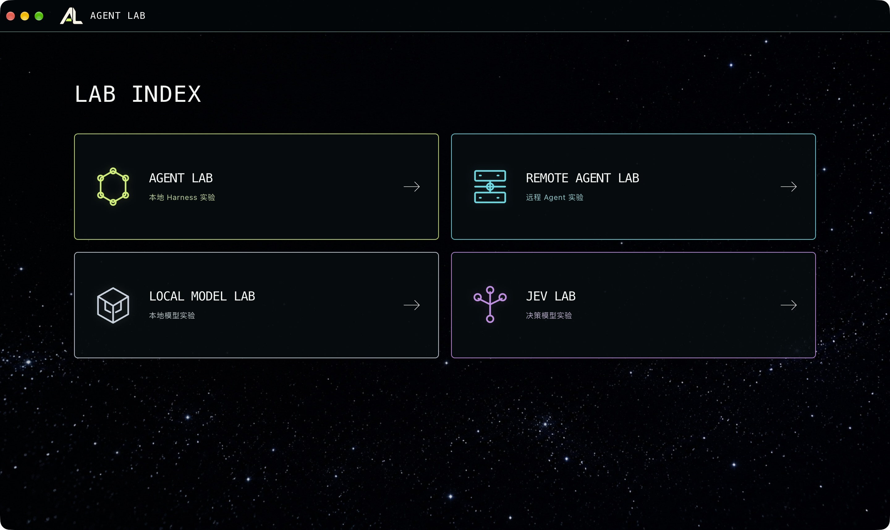
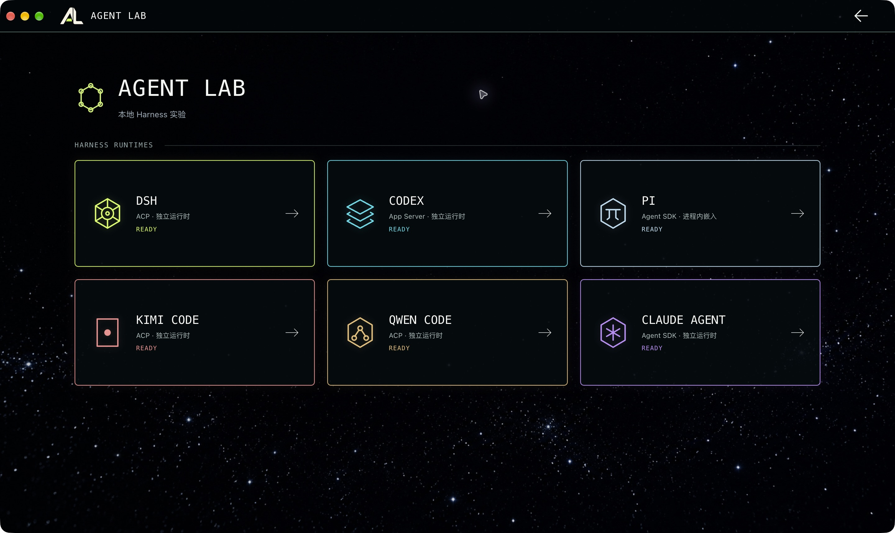

<div align="center">
  
  <h1>Agent Lab</h1>
  <p><strong>把智能体放到同一张实验台上。</strong></p>
  <p>本地 Harness · 自部署远端 Agent · 本地模型 · 决策实验</p>
  <p>
    <a href="#下载安装包">下载安装包</a> ·
    <a href="#快速开始">源码运行</a> ·
    <a href="#四个实验室">四个实验室</a> ·
    <a href="#服务端部署">服务端部署</a> ·
    <a href="#桌面打包">桌面打包</a> ·
    <a href="#数据与安全">数据与安全</a>
  </p>
</div>

<p align="center"></p>

Agent Lab 是一个面向智能体研发、能力验证与对照实验的 **Electron + TypeScript 桌面实验平台**，集成本地 Harness、自部署远端服务、本地模型和决策实验。

各实验室使用独立的运行时或服务，提供连接配置、会话、执行过程、审批和产物展示。工具、权限、上下文与扩展能力由各 Harness 的接入方式决定，适合通过实际任务观察它们的差异。

**当前为研发预览项目，发行采用 Pre-release 标记。** 已发布的平台与附件以 [GitHub Releases](https://github.com/SelfMeAI/agent-lab/releases) 为准；源码 CI、安装包原生自动验收和真实设备兼容性是不同的验证层级。安装包不附带 API Key、个人数据或模型权重；远端服务镜像通过公开 GHCR 单独提供。

## 四个实验室

| 实验室 | 实验对象 | 可以做什么 | 需要 Docker |
| --- | --- | --- | --- |
| Agent Lab | DSH、Codex、Pi、Kimi Code、Qwen Code、Claude Agent | 本地任务、会话、工具调用、文件变更与产物观察 | 否 |
| Remote Agent Lab | OpenHands、OpenClaw | 自部署服务、远端任务、浏览器/桌面观察、终端与文件预览 | 是 |
| Local Model Lab | Ollama 与不同开源模型 | 模型下载管理、单模型对话、双模型对照 | 否 |
| JEV Lab | TypeSafe JEV 决策 API | 象棋、智能体审核、客户行动、发票分流四类决策实验 | 否 |

### Agent Lab

<p align="center"></p>

- 六个独立入口、连接设置和会话空间，使用项目内准备的运行时，无需全局安装对应 CLI。
- 增量对话、工具动作、结果与产物，文件变更以红绿 Diff 展示。
- 原生审批选项与用户提问；“始终允许”以实际提供的授权范围为准，不代表允许所有操作。
- 多会话、并行执行、最近删除与恢复；输入方式按会话保存。
- **Queue**：为当前工作结束后的下一轮保存消息。**Steer**：通过对应 Harness 的接入机制中途补充。两者不是同一个发送时机。
- 多行输入、Shift + Enter 换行、运行与动作耗时、跨日会话时间展示。

### Remote Agent Lab

OpenHands 与 OpenClaw 使用独立的 Docker 服务、配置和数据卷。

- **OpenHands**：浏览器观察、执行过程、终端、文件和产物预览。
- **OpenClaw**：可观察、可操作的远端桌面，包含 Chrome、终端、文件管理器与回收站。
- 文件通过上传/下载交换；远端任务不使用客户端的本地工作目录。
- 服务管理面板可以查看状态、启动、停止服务；任务输入队列与模式由服务端持久化。
- 图片、文本/代码、HTML、PDF 可预览；`.doc/.docx`、`.xls/.xlsx`、`.ppt/.pptx` 经隔离的办公文档渲染服务转换后预览。不支持的格式仍可下载。

OpenClaw 桌面终端与外部终端连接同一人工 Shell，智能体命令记录独立展示。关闭客户端不会停止远端服务或任务。

### Local Model Lab

内置固定版本的官方 Ollama 运行时，不要求另装系统 Ollama。模型目录支持安装、下载进度、暂停/继续、取消后重试、已安装模型管理；可在 Playground 中对话，或用同一提示进行双模型对照。

模型权重首次使用时下载，保存在应用配置指定的目录中，不随安装包分发。模型各自有硬件需求和许可；GGUF 文件能否运行取决于模型架构与 Ollama 的支持情况。

### JEV Lab

JEV 是远端决策服务，四个实验用于观察候选选择、置信度、概率、耗时与决策结果，通过 API 接入，无需本机 Docker。

象棋支持人类执红、自对弈、单步、自动/暂停、重开与合法着校验。**未配置 JEV 或 API 请求失败时，结果可能来自本地规则回退，界面会明确标记。** API 失败会停止自动对弈。

## 下载安装包

这条路径**不需要下载源码，也不需要安装 Node、Rust 或 Python**。

1. 在 [Releases](https://github.com/SelfMeAI/agent-lab/releases) 下载对应系统与 CPU 的安装包，并按该版本 `SHA256SUMS.txt` 核对文件。不要混用不同版本的安装包与镜像准备脚本。
2. macOS 使用 DMG 或 ZIP；Windows 使用 EXE；Linux 使用 AppImage，先赋予执行权限。当前包未做 macOS 签名/公证或 Windows 代码签名，系统可能提示来源无法验证；核对来源后按系统正常流程处理，不要全局关闭安全保护。
3. 打开应用，在相应实验室设置自己的模型/API 连接。分发包内置六种本地 Harness 与 Ollama，不需要另外安装相应 CLI。Ollama 还需下载模型权重并满足模型的内存/显存要求；JEV 的真实决策需配置自己的服务连接。

**Linux 桌面前提**：AppImage 需要可用的 FUSE 2（Ubuntu 24.04 的库包名为 `libfuse2t64`）；没有 FUSE 时可用 `./Agent-Lab-0.1.0-linux-x64.AppImage --appimage-extract-and-run`。具体说明见 [AppImage 官方 FUSE 指南](https://docs.appimage.org/user-guide/troubleshooting/fuse.html)。Electron 沙箱还依赖系统允许的用户命名空间；遵循发行版的安全配置，不要为运行应用全局关闭 AppArmor 或沙箱。保存连接 Key 需要桌面会话中可用的 Secret Service/KWallet。

Linux/WSL2 使用 Codex 时，先安装发行版的 `bubblewrap`（Ubuntu/Debian：`sudo apt install bubblewrap`）。Ubuntu 24.04 如限制用户命名空间，按 [OpenAI 官方沙箱前提](https://learn.chatgpt.com/docs/sandboxing#prerequisites) 加载对应的 bwrap AppArmor 配置，不需要关闭整个系统的保护。

**只有 Remote Agent Lab 需要 Docker。** 先安装并启动 Docker Desktop（macOS/Windows）或 Docker Engine（Linux），使用 Linux 容器，Docker 26+；镜像支持 `amd64` 与 `arm64`。建议为 Docker 提供至少 8 GB 内存，并为两套浏览器环境和缓存预留数十 GB 磁盘空间。

从**同一版本 Release** 下载 `prepare-remote.sh`（macOS/Linux）或 `prepare-remote.ps1`（Windows），终端切到下载目录后运行：

```sh
# macOS / Linux：准备两种远端服务
sh prepare-remote.sh

# 也可以只准备一种
sh prepare-remote.sh openclaw
```

```powershell
# Windows：仅对本次命令临时允许运行已核对的脚本
powershell -NoProfile -ExecutionPolicy Bypass -File .\prepare-remote.ps1
```

脚本只要求 Docker，通过公开的固定 digest 拉取并验证镜像，再设置应用需要的本地标签；**无需 GitHub 登录，不会下载源码、编译服务、启动/删除容器、删除数据卷或更改网络配置**。下载中断后可重跑，Docker 复用已下载的层。

准备完成后，进入 **Remote Agent Lab → 服务管理**，启动所需服务并配置自己的模型连接。桌面应用与镜像仍使用本机自部署的研发模式，不是直接暴露公网的多租户服务。

每个 Release 附 `release-manifest.json`（源码 commit、安装包 SHA-256、镜像 digest）、校验表、准备脚本及桌面组件对应源码。只使用其他三个实验室时，可以不下载脚本/镜像、不安装 Docker。

## 快速开始

以下步骤用于从源码运行。在**项目根目录**执行命令。

### 1. 准备环境

- 推荐 **Node.js 24 LTS**，最低 `22.19.0`，以及随 Node 安装的 npm。
- Git、curl、tar。Windows 使用 Git for Windows；Linux 还需要 zstd 解压 Ollama。
- 需要访问 npm registry、GitHub Releases；下载模型时还可能访问 Ollama/Hugging Face。
- Rust 仅在自行编译 Codex 时需要；Docker 仅在使用远端实验室时需要。**未安装 Docker 也可以运行、构建和打包桌面应用，使用其他三个实验室。**
- 少数原生 npm 依赖没有匹配预编译包时，node-gyp 还需要 Python 3 与本平台 C/C++ 工具链。

```bash
git clone https://github.com/SelfMeAI/agent-lab.git
cd agent-lab
npm ci
npm run doctor
npm run prepare:runtimes
npm run dev
```

`npm ci` 安装锁定依赖并准备 DSH、Pi；`prepare:runtimes` 准备 Kimi、Qwen、Claude 与 Ollama。首次会下载较大的官方运行包，请预留时间和磁盘空间。

默认 `doctor` 只检查桌面开发环境。**Codex 需另行编译；远端实验室需另行检查 Docker 并构建服务镜像。** `npm run dev` 会检查和准备本地运行时，不会自动编译 Codex 或构建远端服务。

### 2. 配置连接

进入对应工作区右上角设置，填写接口地址、模型 ID 与 API Key。设置可再次修改；服务支持模型目录时可获取模型列表。

| 本地 Harness | 当前接入方式 | 当前模型连接 |
| --- | --- | --- |
| DSH | 独立 Node 运行时，ACP | DeepSeek 兼容接口 |
| Codex | 自行源码编译的 app-server | OpenAI Responses API |
| Pi | 进程内 Agent SDK | DeepSeek 兼容 Chat Completions |
| Kimi Code | 独立 Node 运行时，ACP | OpenAI 兼容 Chat Completions |
| Qwen Code | 独立 Node 运行时，ACP | OpenAI 兼容 Chat Completions |
| Claude Agent | 官方 Agent SDK + 独立可执行文件 | Anthropic Messages API |

模型服务需支持所选 Harness 的请求协议。Codex 需要 Responses API，Claude Agent 需要 Anthropic Messages API，只有 Chat Completions 的接口不能直接用于这两者。JEV 在自己的设置中配置 TypeSafe 连接；Ollama 本地推理无需云端模型 Key。

## Codex 源码编译

Codex 从锁定版本的 [官方源码](https://github.com/openai/codex) 编译，运行包不随源码仓库提供。准备 Rust 与对应平台工具链后执行：

```bash
rustup toolchain install 1.95.0 --profile minimal
npm run doctor -- --scope codex
npm run build:codex -- --jobs 2
npm run verify:codex
```

平台工具链要求：

- **macOS**：Xcode Command Line Tools；尚未安装时运行 `xcode-select --install`。
- **Windows x64**：Visual Studio 2022 C++ Build Tools 与 Windows SDK，在 x64 Developer PowerShell 中运行编译命令。脚本在已验证的项目源码缓存仓库内启用 Git 长路径支持，不改全局 Git 配置或系统注册表。
- **Linux/glibc**：C/C++ 编译器、pkg-config、OpenSSL 与 libcap 开发包（bwrap 构建依赖）。Debian/Ubuntu 可用 `sudo apt-get install build-essential pkg-config libssl-dev libcap-dev zstd`。

首次编译可能需要数十分钟与数十 GB 缓存空间；`--jobs 2` 用于控制内存占用，可按设备调整。之后复用 Cargo 缓存。

构建包含 **Codex CLI + Code Mode host + ripgrep**，Linux 还包含 bwrap，Windows 还包含 command runner 与 sandbox setup。

发行包保留各组件许可。包含 Linux 安装包的 Release 还提供 `codex-component-source` 附件，保留 bwrap/bubblewrap 的对应源码、编译锁文件和构建说明；正常运行应用不需要下载这个源码附件。

源码、工具链和编译依赖由 [`runtimes/codex/source.json`](runtimes/codex/source.json) 锁定。Codex 与 host 从源码编译，V8 使用校验过的上游构建依赖。

源码、V8 与编译缓存集中在项目 `.cache/`，运行包生成在 `runtimes/codex/`。打包前会校验当前平台的版本、布局和文件哈希。

只看计划而不编译：`npm run build:codex -- --plan`。同时准备并按需编译 Codex：`npm run prepare:runtimes -- --codex`。

## 服务端部署

**安装包使用者**按上面的镜像准备步骤即可。以下用于从源码构建/修改服务，不是运行 Release 的必经步骤。

### 1. 构建固定源码镜像

Mac/Windows 使用运行中的 Docker Desktop，Linux 可使用 Docker Engine，运行 **Linux 容器**。建议至少给 Docker 8 GB 内存；两套浏览器环境同时运行或构建时可能需要更多。

`remote:build` 在下载源码前检查 Docker。未安装、无法连接服务或处于 Windows 容器模式时，会给出中文提示并停止，不会自动安装 Docker、启动服务或修改 context。

```bash
npm run doctor -- --scope remote
npm run remote:build -- openhands
npm run remote:build -- openclaw
```

构建脚本会获取对应的固定上游源码，构建原生服务，再应用仓库内的部署层和扩展。办公文档预览使用固定镜像与 digest，无需你在宿主机安装 Python、LibreOffice、Chrome 或 Linux 桌面。

想先查看源码或构建计划：

```bash
npm run remote:source -- openhands --source sdk
npm run remote:source -- openclaw
npm run remote:build -- openhands --plan
npm run remote:build -- openclaw --plan
```

`--plan` 不要求 Docker，也不构建镜像，但首次仍会获取和校验源码。OpenHands 执行服务基于 **Software Agent SDK**；锁文件中的完整 OpenHands app 为可选参考。

### 2. 在应用中启动

进入 Remote Agent Lab → 服务管理，启动所需服务，再设置模型连接。客户端与本机研发服务的身份凭据自动生成。

默认服务仅绑定 `127.0.0.1`，不把宿主机工作目录挂进远端任务。配置、会话、上传文件与产物保存在应用专属 Docker 数据卷中。**停止容器不等于删除数据；删除数据卷会丢失服务端数据。** 不要为排障直接清空 Docker volumes。

当前仅支持本机自部署的研发环境，不提供公网部署或生产级多租户方案。

## 桌面打包

运行时准备完毕并通过 Codex 校验后，在**目标操作系统和目标 CPU 架构的原生环境**打包。脚本不支持跨平台混用运行时；桌面打包不需要 Docker。

```bash
# 当前平台的正式分发格式
npm run package

# 分别在对应平台执行
npm run package:mac
npm run package:win
npm run package:linux

# 只生成可运行目录，便于本机测试
npm run package:dir
```

| 目标 | 默认分发格式 | 原生验收环境 |
| --- | --- | --- |
| macOS Apple Silicon | DMG + ZIP | `macos-15`，另有本机运行验收 |
| macOS Intel | DMG + ZIP | `macos-15-intel` |
| Windows x64 | NSIS 安装程序 | `windows-2022`；面向 Windows 10/11 x64 |
| Linux x64 / glibc | AppImage | `ubuntu-24.04`；其他发行版未实机验收 |

发布工作流从最终 ZIP/AppImage 解包后的应用启动验收，Windows 则在隔离 CI 中安装 EXE 后验收；选中的目标通过原生编译、实际窗口/IPC 启动、内置 Harness 加载和模拟模型交互回归后，才纳入 Release。Linux CI 验证解出的 AppImage 内容，不替代各发行版 FUSE/桌面安全策略的实机检查。**表格是构建/验收矩阵，不表示每个平台已经有可下载的成功产物**；实际支持范围以对应 Release 附件及清单为准。自动验收不能代替所有真实设备、操作系统版本或模型服务的兼容性测试。

Windows/Linux ARM64 有运行时恢复路径，但不在当前默认发布矩阵内，不作为已经验收的平台承诺。

产物统一放在 `release/`。本机 Mac 输出示例：

```text
release/
├── mac-arm64/Agent Lab.app
├── Agent-Lab-0.1.0-mac-arm64.dmg
└── Agent-Lab-0.1.0-mac-arm64.zip
```

分发包包含对应平台的本地运行时，但不含个人配置、会话、模型权重或 Docker 服务镜像。应用图标由打包器生成对应平台格式。

**当前包未配置 macOS 签名/公证和 Windows 代码签名，也没有自动更新。** 系统可能提示来源无法验证。请先核对仓库与构建来源，再按系统正常流程判断是否允许运行；不要为运行本项目全局关闭系统安全保护。

自动源码检查见 [Source checks](https://github.com/SelfMeAI/agent-lab/actions/workflows/check.yml)；原生打包可手动触发 [Native desktop packages](https://github.com/SelfMeAI/agent-lab/actions/workflows/package.yml)，生成 CI 下载产物，不自动发布 GitHub Release。

### 维护者发版

提交代码与发版分开：普通 push/PR 只运行源码检查。[Release](https://github.com/SelfMeAI/agent-lab/actions/workflows/release.yml) **只能手动触发**，从选定源码 commit 原生构建安装包，并从锁定上游源码构建两种服务的 Linux amd64/arm64 镜像。

先提交根目录与桌面 `package.json` 一致的版本号（及锁文件），再在 Actions → Release 输入同一版本号、选择桌面目标。默认创建草稿；勾选 `publish` 才在全部验证通过后公开 Pre-release。已经公开的版本不可覆盖，需要增加版本号。可用 `npm run release:plan` 本地核对固定来源与发布目标。

首次 GHCR 容器包默认为 Private，需要在对应包设置里改为 **Public**；工作流会验证匿名拉取，不能公开下载的镜像不会进入 Release。不需要把个人 registry token 写进仓库，工作流仅使用 GitHub 的短期 `GITHUB_TOKEN`。首次设置后，后续版本沿用公开包。

## 架构与目录

```text
Electron 桌面应用
├── 本地适配器 → 内置 Harness / Pi SDK → 所选本地工作目录
├── HTTP / WebSocket → OpenHands、OpenClaw 服务 → 服务端任务与文件
├── LocalModelService → Ollama → 本机模型目录
└── JEV 实验 → TypeSafe 远端决策 API
```

```text
apps/desktop/
├── src/main/                 窗口、IPC、SQLite、凭据、运行时与服务管理
├── src/preload/              渲染进程的受控桌面接口
├── src/renderer/             应用壳和四个实验室
└── electron-builder.yml      多平台分发与图标配置
packages/
├── contracts/               共享类型与交互契约
├── runtime/                 六种 Harness 适配器、审批/提问/消息桥接
└── remote-agent/            服务通信、模型设置、任务、文件与预览
services/remote-agent/
├── openhands/               源码锁、部署层、扩展和验证
├── openclaw/                源码锁、部署层、桌面和验证
└── document-preview/        办公文档转换服务
runtimes/                    固定运行时清单、许可与接入加载器
scripts/                     环境检查、恢复、编译、校验、打包与服务脚本
assets/                      品牌、背景与 README 实机截图
.github/workflows/           源码检查、原生打包与手动 Release
.cache/ / .work/ / release/  缓存、临时验证与构建产物，不入 Git
```

Renderer 不直接读取密钥或执行系统命令。窗口启用 sandbox、context isolation，关闭 Node integration；桌面能力通过 preload 的窄接口与主进程收口。

## 数据与安全

### 个人数据不在安装包内

新安装的默认应用数据目录：

| 系统 | 目录 |
| --- | --- |
| macOS | `~/Library/Application Support/Agent Lab/` |
| Windows | `%APPDATA%\Agent Lab\` |
| Linux | `$XDG_CONFIG_HOME/Agent Lab/`，未设置时通常为 `~/.config/Agent Lab/` |

其中包含 `agent-sessions.sqlite`、`local-model-runs.sqlite`、应用/模型配置 JSON、加密连接设置、`runtime-homes/` 和默认本地模型目录。应用会话与实验记录保存在 SQLite，各 Harness 的原生上下文保存在独立 runtime home 中。

旧版安装会继续使用原有数据目录与加密身份，可能保留 `SelfMe Lab` 路径，以兼容既有会话、凭据和 Docker 数据卷。不要直接移动该目录或跨系统复制加密设置。

### 凭据与执行边界

- 本地 Harness 的模型连接 Key 和研发服务认证凭据使用 Electron 系统凭据加密。Linux 需要可用的 Secret Service/KWallet，缺失时拒绝保存。
- API Key 由使用者自行提供，模型服务可能产生费用。远端模型配置保存在对应服务的私有数据卷内。
- 工作目录是任务范围，**不等于所有工具都拥有强安全沙箱**。允许执行命令后，部分 Harness 的命令仍可能访问目录外或网络；请用可恢复的测试项目，不直接授权处理敏感生产数据。
- 远端环境使用容器/任务工作区隔离；本机开发服务不是对抗恶意租户的安全边界，不应直接暴露公网。
- 提交日志、截图、数据库或 Issue 前，请删除 API Key、个人路径、任务内容与私密文件。

### 第三方依赖

依赖版本与运行时来源由锁文件、清单和恢复脚本管理。Pi、Qwen 等运行时包含固定的依赖修正，详见 [第三方通知](THIRD_PARTY_NOTICES.txt)。

**开发工具链仍存在已知上游审计项。** npm 审计不涵盖闭源可执行文件、Rust/Cargo 的全部依赖或容器系统软件。需要检查 npm 生产依赖时，可执行：

```bash
npm audit --omit=dev
npm audit --prefix runtimes/dsh --omit=dev
npm audit --prefix runtimes/kimi-code --omit=dev
npm audit --prefix runtimes/qwen-code --omit=dev
```

开发依赖需另运行不带 `--omit=dev` 的审计。升级依赖后应重新验证运行时兼容性。

## 验证与贡献

安装项目依赖后，先准备常规测试需要的 Kimi、Qwen 运行时；已执行 `prepare:runtimes` 时可省略前两条命令：

```bash
npm run ensure:kimi
npm run ensure:qwen
npm run typecheck
npm test
npm run test:scripts
npm run test:remote
npm run check:source
```

常规测试无需 Docker 或付费模型连接。需要完整原生运行时或 Docker 服务镜像的集成测试通过环境变量单独启用，默认跳过；源码 CI 不代替这些集成测试或安装包实机验证。

真实 Harness 与容器测试使用临时工作区、测试身份和本地模拟模型服务，相关开关见各 `*.integration.test.ts`。例如，已准备运行时后可执行：

```bash
# macOS / Linux；Windows PowerShell 请先设置对应环境变量
AGENT_LAB_STEERING_INTEGRATION=1 npm run test --workspace @agent-lab/desktop -- packages/runtime/src/user-questions.integration.test.ts
AGENT_LAB_REMOTE_INTEGRATION=1 npm run test --workspace @agent-lab/desktop -- apps/desktop/src/main/remote-agent/service-manager.integration.test.ts
```

`check:source` 检查常见凭据和误提交的生成/个人文件，不能替代人工审核或专用秘密扫描。更新运行时时，请同步锁文件、加载器和第三方通知，并运行对应集成测试。

反馈问题请通过 [Issues](https://github.com/SelfMeAI/agent-lab/issues) 提供系统/应用版本、复现步骤、预期行为与脱敏日志。欢迎围绕具体实验能力、兼容性或可复现问题提交改进。

## 常见问题

**需要先安装 Codex、Claude Code、Ollama 吗？**

不需要全局安装。源码运行需要先恢复项目运行时；分发包已经带上对应本地运行时。API 连接和模型权重仍需自己准备。

**为什么第一次启动准备很慢？**

可能正在下载官方运行包。首次 Codex 编译、Docker 镜像构建和模型权重下载都比较大，它们是不同步骤。脚本保留项目内缓存以便重试；不会擅自改代理或 DNS。

**“Codex 尚未准备”怎么办？**

运行 `npm run doctor -- --scope codex`，按提示补齐工具链，再执行 `npm run build:codex` 与 `npm run verify:codex`。不要复制其他架构的二进制，也不要省掉 Code Mode host。

**没有安装 Docker 能用吗？**

可以使用 Agent Lab、Local Model Lab 和 JEV Lab，桌面开发与打包也不依赖 Docker。Remote Agent Lab 需要安装并启动 Docker；环境缺失时服务面板会提示，其他实验室仍可使用。

**桌面包能独自启动远端实验室吗？**

分发包包含客户端，不包含体积很大的 Docker 镜像。安装并启动 Docker，运行同版本 Release 的镜像准备脚本后，即可在应用中启动服务，不需要源码。远端任务在容器中执行，客户端通过 API 交互和观察。

## 许可证与致谢

Agent Lab 原创代码采用 [Apache License 2.0](LICENSE)。第三方软件、模型、商标与服务保留各自许可和条款，详见 [第三方通知](THIRD_PARTY_NOTICES.txt) 与 [NOTICE](NOTICE)。

特别注意：**Claude Code 可执行文件并不是开源组件**，来自官方 Agent SDK 平台包，适用 [Anthropic SDK 条款](https://code.claude.com/docs/en/agent-sdk/overview#license-and-terms) 与 [法律/合规说明](https://code.claude.com/docs/en/legal-and-compliance)；本项目的 Apache 许可不能替代它们，也不授予第三方模型或服务的使用资格。

感谢 [DeepSeek Harness](https://github.com/deepseek-ai/deepseek-harness)、[Codex](https://github.com/openai/codex)、[Pi](https://github.com/earendil-works/pi)、[Kimi Code](https://github.com/MoonshotAI/kimi-code)、[Qwen Code](https://github.com/QwenLM/qwen-code)、[OpenHands SDK](https://github.com/OpenHands/software-agent-sdk)、[OpenClaw](https://github.com/openclaw/openclaw)、[Ollama](https://github.com/ollama/ollama) 与其他依赖的维护者。本项目独立开发，不代表上述厂商的官方产品。
